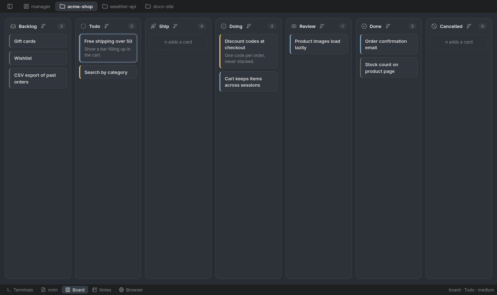
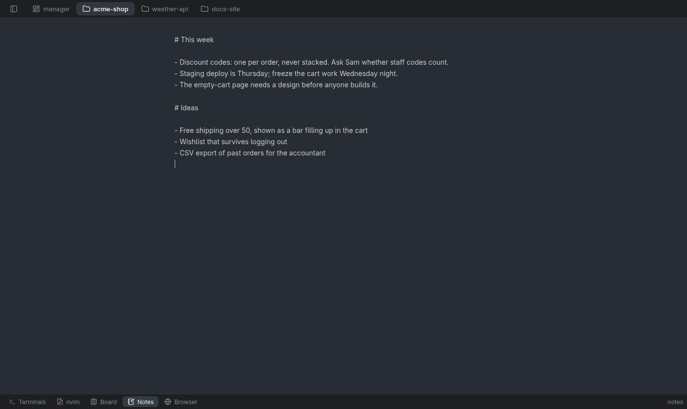

# dashboard

Keyboard-first terminal dashboard for running Claude Code across several projects. Each project is a
page: its main Claude session on the left, the workers that session dispatches on the right, and a
kanban board, a notes page, an nvim and a web browser one key away. The first tab, the manager, is
every project at once. [docs/](docs/README.md) has a folder per feature with the detail.

## What it does

- **The Claude screen.** A project's main session is Claude Code drawn as a page rather than a
  terminal: tables as tables, highlighted code, diffs, images, slash commands and rewind. It runs
  with the project's own CLAUDE.md, settings, skills, hooks and MCP servers.
  [Chat](docs/chat/README.md)
- **Workers.** Main hands tasks to workers with `node "$DASHBOARD_COMMAND" pane start "<task>"`,
  each in a pane of its own, and hears back when one is done. A pool holds them to 4 running in a
  project and 8 in all (`workers.cap`, `workers.totalCap`); a start past either is queued and
  starts when a slot frees. Alt+W on the Claude screen lists main's workers and its queue, Enter
  goes to one, D withdraws a queued start. [Workers](docs/workers/README.md)
- **The board.** Backlog, Todo, Ship, Doing, Review, Done and Cancelled, one file per card under
  `.dashboard/board/`. Moving a card into Ship makes a branch and a worktree and starts an agent on
  it; its pull request moves the card from then on, and a review runs `/pr-loop` on it. With merging
  on, `dashboard pr land` merges it once CI is green. Agents edit the board only through the `board`
  command. [Board](docs/board/README.md), [Ship](docs/ship/README.md)
- **Notes.** A page of free text and a page of handwriting per project, kept beside the board.
  [Notes](docs/notes/README.md)
- **The browser.** A web browser per project with its own sign-ins, so a site signed in once stays
  signed in for that project. Agents drive the same tabs with `dashboard browser` (open, read,
  screenshot, click, type), and `browser.proxy` in the settings sends the sites it lists through a
  proxy. [Browser](docs/browser/README.md)
- **The manager.** What needs you across every project, longest waiting first, a board of every open
  project, a command run across projects, its own board, notes and terminals, the log.
  [Manager](docs/manager/README.md)
- **Usage.** Tokens per project and per pane, from Claude Code's own logs: this five-hour window,
  this week and all time. [Usage](docs/usage/README.md)
- **Settings and updates.** Ctrl+, edits every key, the theme, the font and the shell; the window's
  opacity is set in the file. A newer release is named on the status bar and installed with
  Ctrl+Shift+G. [Settings](docs/settings/README.md), [Updates](docs/updates/README.md)

| Board | Notes |
|---|---|
|  |  |

## Setup

    cp .env.example .env   # optional: SHELL_COMMAND
    corepack enable        # pnpm, at the version packageManager pins
    pnpm install
    pnpm start

On Windows, [docs/app/windows-setup.md](docs/app/windows-setup.md) walks through it step by step,
folder by folder.

While the installed app is running, `pnpm start` on its own only brings that app's window to the
front and exits: one app runs per userData folder. "One app at a time" in `docs/app/README.md` says
how to run a development copy beside it.

## Install

Download the build for your system from [Releases](https://github.com/naeemba/dashboard/releases): a `.dmg` or `.zip` for a mac with Apple silicon, the `Setup.exe` for Windows, a `.deb`, `.rpm` or `.zip` for Linux. The builds are not signed, so each system warns once before the first launch:

- macOS: Control-click Dashboard.app in Applications and choose Open, then Open again. On macOS 15
  and later, open it once, then go to System Settings → Privacy & Security and click Open Anyway.
- Windows: SmartScreen says "Windows protected your PC". Click More info, then Run anyway.

After that the app keeps itself up to date: when a newer release is out the status bar says so, and
Ctrl+Shift+G downloads it and restarts into it when you pick Restart. A Linux zip install updates in
place wherever you unpacked it. [Updates](docs/updates/README.md) has the rest.

To build and install from this checkout instead:

    scripts/rebuild.sh

It packages the app and installs it to `/Applications/Dashboard.app` on a mac,
`~/.local/opt/dashboard` on Linux or `%LOCALAPPDATA%\Programs\Dashboard` on Windows (from Git Bash;
[Windows setup](docs/app/windows-setup.md)), leaving any running copy alone. On Linux nothing adds a
launcher: run `~/.local/opt/dashboard/Dashboard`, or point a desktop entry of your own at it.

To cut a release, on main with CI green: `scripts/release.sh minor` (or `major`, `patch`;
`/release minor` in Claude Code). It runs the Release workflow, waits for it, then installs the new
version here the way `scripts/rebuild.sh` does. [Workflow](docs/workflow/README.md#how-to-release)
has the rest.

On a mac, building signs the app with a self-signed certificate named `Dashboard Local` in the login
keychain, and fails without it. Create it once in Keychain Access → Certificate Assistant → Create a
Certificate…, Identity Type *Self Signed Root*, Certificate Type *Code Signing*. Recreating it makes
macOS ask for folder access once more.

Every launch of the installed app also installs the `/create-task` and `/adopt-docs` skills for
Claude Code, rewriting a file only when this build's copy differs:

- `~/.claude/skills/create-task/SKILL.md`: the `/create-task` command
- `~/.claude/skills/create-task/create-task.js`: the program it runs, at a path that does not move.
  Point `PR_LOOP_CARD_SCRIPT` at it; it takes `--title`, `--notes`, `--priority` and, for a board on
  a remote other than `origin`, `--remote <name>`. It works outside a Dashboard pane.
  [Board](docs/board/README.md#create-task) has the rest.
- `~/.claude/skills/create-task/package.json`: `{"type":"commonjs"}`, so a `"type": "module"`
  package.json above it cannot make node read the program as ESM
- `~/.claude/skills/adopt-docs/SKILL.md`: the `/adopt-docs` command, which moves a repository's docs
  into the `docs/<feature>/` pattern and opens one pull request. [Skills](docs/skills/README.md) has
  the rest.

The installed app reads `$XDG_CONFIG_HOME/dashboard/.env` (falling back to
`~/.config/dashboard/.env`) instead of the repo `.env`.

The window opens on the projects the last run was left on — the same order, each on the view it was
showing, with the same pane focused; the layout lives in `session.json` under the app's data
directory, next to `recents.json`. A project whose folder has since gone away comes back once as a
dead tab and is then forgotten, so it costs you the tab on one launch rather than every launch. With
nothing saved the window opens empty. Ctrl+S lists the projects you opened before and offers a
folder dialog for a new one.

Closing the window asks first, because it kills every shell in every project and there is no getting
a long-running task back. Cancel is the default, so Enter and Escape both mean "I hit that by
accident".

## Shortcuts

Mod is Cmd on macOS, Ctrl on Linux and Windows.

| Action | Keys |
|---|---|
| Shortcuts for the screen you are on | Ctrl+H |
| Terminals mode | Ctrl+T |
| Nvim mode | Ctrl+N |
| Board mode | Ctrl+B |
| Notes mode | Ctrl+Shift+N |
| Browser mode | Ctrl+Shift+B |
| Open the project list | Ctrl+S |
| Settings | Ctrl+, |
| Jump to project N | Ctrl+1..9 |

Every other key is in Ctrl+H, printed from the one table in `src/shared/keys/actions.ts`, so that
dialog is always current where this file might not be: the screen in front of you first, then the
modes, then the projects. Each section opens with a sentence saying what that screen is. Escape or
Enter closes it. It is the one shortcut no mode passes through, so Ctrl+H no longer reaches a shell
or nvim as a backspace.

## Settings

Ctrl+, opens a settings screen for every key, the theme, the font, the shell and the place the
manager's weather card reads. It writes to `~/.config/dashboard/settings.json` (or
`$XDG_CONFIG_HOME/dashboard/settings.json`), which you can also edit by hand. Every field is
optional — leave one out and it falls back to what the app ships with. The file holds only what you
changed; anything you left alone follows the app's default, including when that default moves. The
app tidies the file each time it starts, so a line you write that already matches the default is
taken out again.

A key binding is written the way you would say it, `Ctrl+Shift+K`, matching the physical key rather
than whatever character the keyboard reports for it, so Option+H is Option+H on any layout. `null`
means no key at all. Delete the file and everything — keys, theme, font, shell — goes back to how it
shipped.

`"opacity": 0.7` in the file lets the desktop show through behind the text, from 0.2 up; it takes
effect at the next launch, and on Linux it needs a compositor.

## Second screen

One Dashboard can show another's session. On the machine that holds the work, open the settings
screen and set a port in the Host section, in the row labelled `Port (next launch)`; the port is
read at the next launch. Copy the token from the `Token` row under it. On the other machine, open
the project list (Ctrl+S) and choose Connect to a host, then type `address:port` and paste the
token. From then on that window is a second screen of the first: the same shells, boards and notes,
with its own selected pane and mode. Each shell is sized to the smaller of the two windows. Choose
Disconnect in the same list to come back to the machine's own projects. Launch with `--remote` to
connect to the last host straight away; launched that way while the app is already running, the
running app connects instead of a second one opening.

The wire is plain text, guarded by the token. It is meant for a home network; a token in the wrong
hands is a shell as you. The host must not sleep on lid close; that is the operating system's
setting.

## Modes

Each project remembers its own mode, so Ctrl+2 lands on project 2 in whatever view you left it in:
terminals, nvim, board, notes or browser. The project keys work from all five; Mod+1..5 and
Option+HJKL only mean something when the terminals are on screen.

The key naming the mode you are already in is passed through to whatever is running there, so Ctrl+N
still completes a word inside nvim and Ctrl+T still transposes characters in a shell. You leave a
mode by naming a different one. Nvim starts the first time you press Ctrl+N for that project, not at
launch.

The board is a folder in the project, `.dashboard/board/`, one file per card, with a `README.md` and
a `CLAUDE.md` describing the format; the notes sit beside it in `.dashboard/notes.md`. Committing
them is your call — nothing touches `.gitignore`. Every change is written straight to disk; there is
no save key. A card file that no longer parses is set aside as `<id>.json.broken` and the status bar
says so.

Every pane the app opens carries `DASHBOARD_BOARD`, the path to a command that edits the board of
the project you are in through the same code the app does. `node "$DASHBOARD_COMMAND" board
<command>` is the same program.

    node "$DASHBOARD_BOARD" list
    node "$DASHBOARD_BOARD" show 0f6a2c5e
    node "$DASHBOARD_BOARD" add "Fix the resize race" --priority high --notes "what goes wrong"
    node "$DASHBOARD_BOARD" ship 0f6a2c5e
    node "$DASHBOARD_BOARD" comment 0f6a2c5e "what was found"

Run it with no arguments for the whole usage. It is the only way an agent changes the board: a hook
refuses a hand edit of the files. A shipped card's column follows its pull request and the app moves
it. [Board](docs/board/README.md) has the rest.

## Known limitations

In the project list, type to filter, Up and Down move, Enter opens, Escape closes. Its last row,
"Open a new project…", is a row like any other, so the folder dialog is reachable without the
mouse — it is the only way in, there is no separate shortcut for it.

Ctrl+O returns to the project you were on before this one, so two projects toggle back and forth.
Ctrl+Shift+1..9 reorders the projects: the one on screen takes that position and the rest shift
along, the way dragging a tab works. Its shells keep running throughout; only the order you cycle
and jump through changes.

Ctrl+S and Ctrl+O are plain Ctrl on every platform, macOS included, so the shell never receives
them: no XOFF, no emacs reverse search, no readline operate-and-get-next inside a pane.

Cmd+Backspace sends Ctrl+U to the shell, which clears the whole line, not just the part before the
cursor — zsh binds ^U to kill-whole-line. It is macOS only: on Linux and Windows Ctrl+U already
reaches the shell on its own.

On Linux and Windows, the Ctrl modifier used for shortcuts also intercepts Ctrl+[ (Escape in
terminals and vim) and Ctrl+Left/Right (word movement), making them unavailable inside the shell.
Ctrl+1..9 belongs to the projects everywhere, so on those platforms Mod+1..5 cannot reach the
terminals — use Mod+Left/Right or Option+HJKL instead. macOS keeps both, since its shortcuts use
Cmd.

## Tests

    pnpm test
